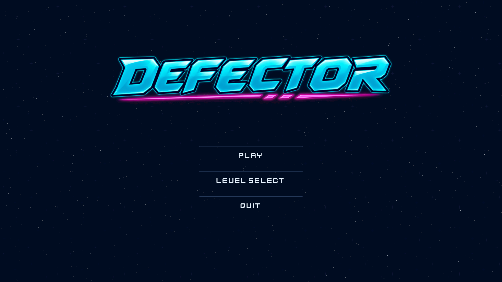
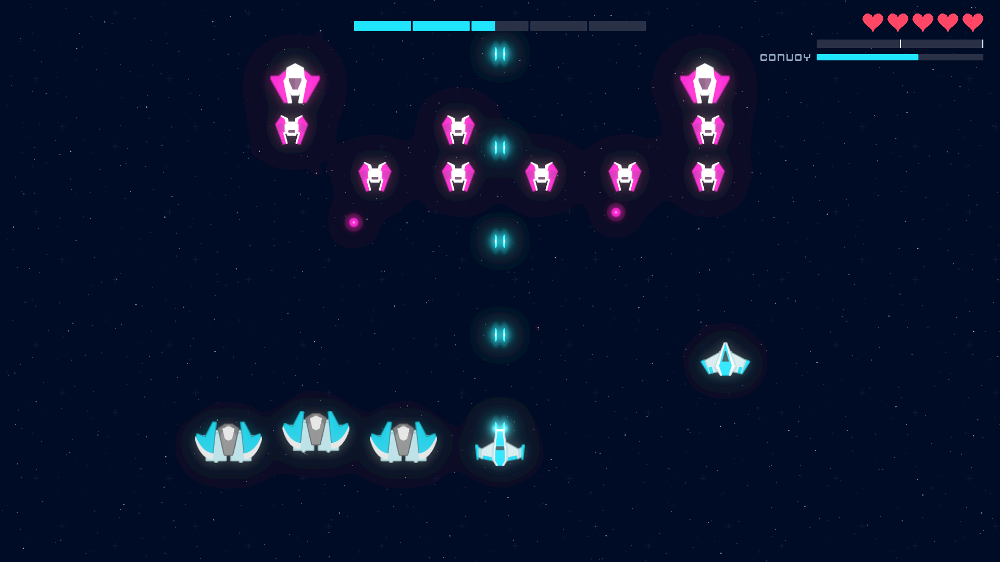
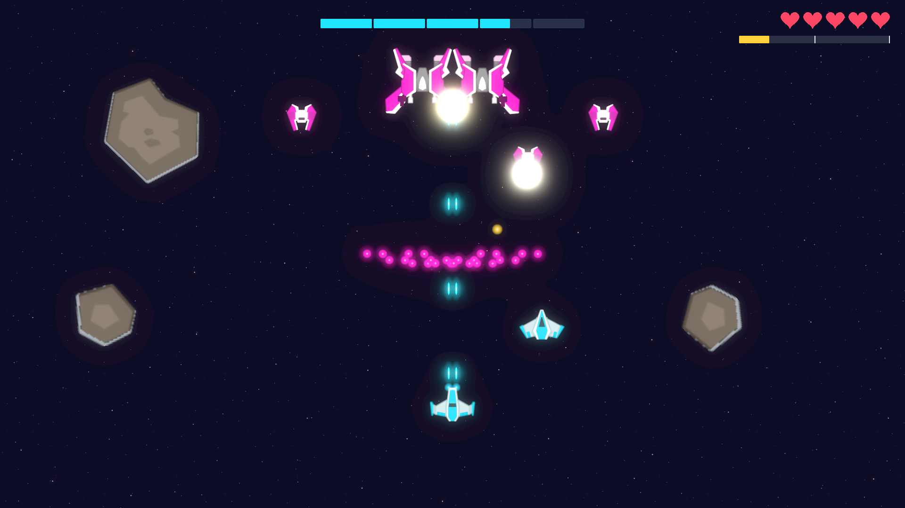
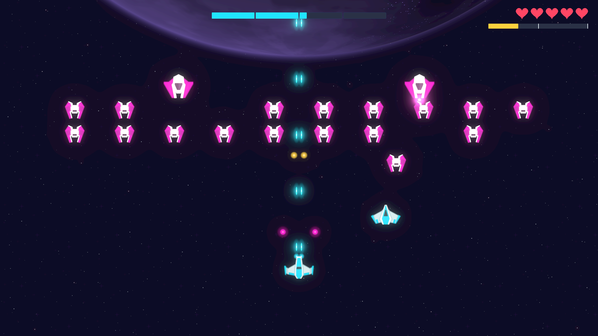
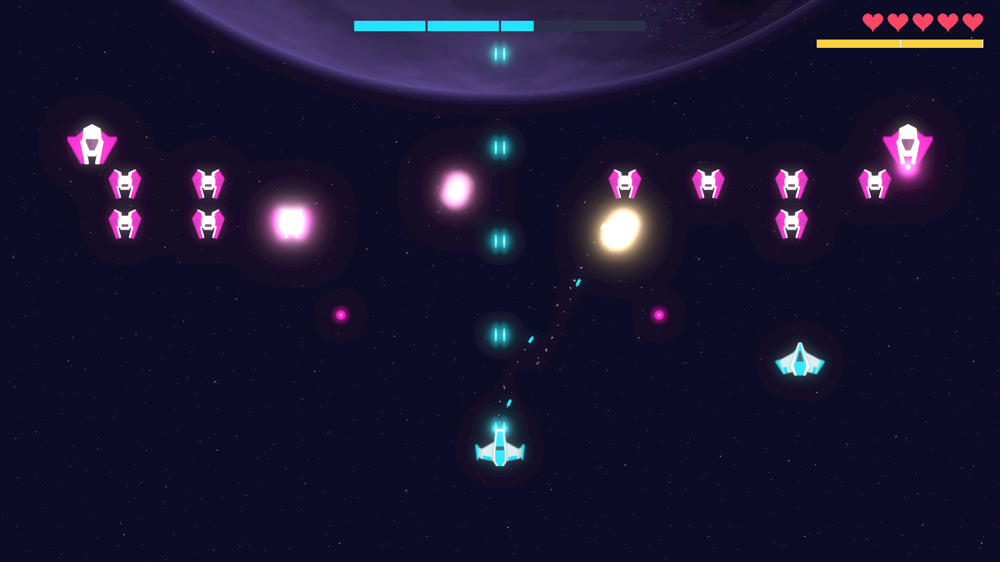
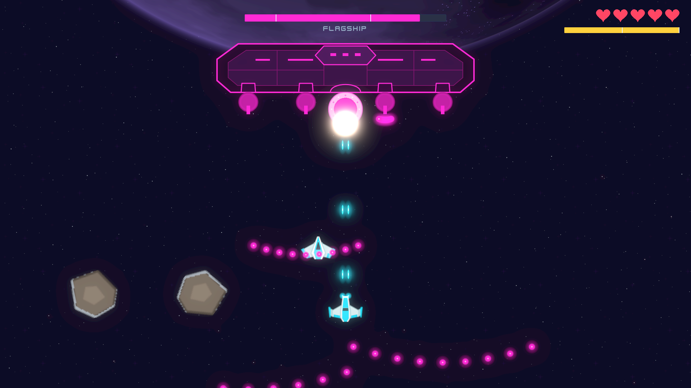
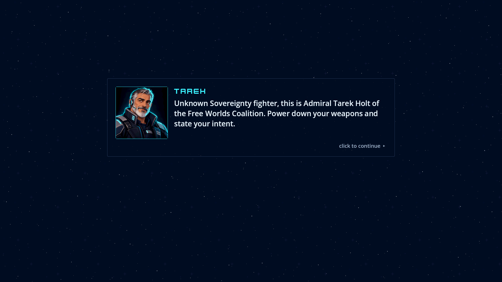
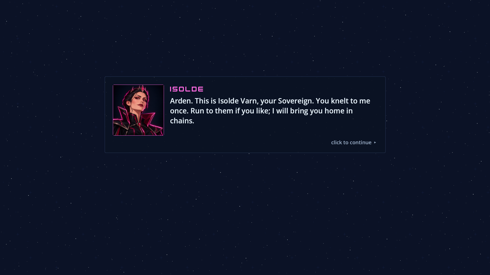

# DEFECTOR


A neon 2D space shooter where every enemy fleet belongs to the woman you used to serve. You play **General Arden Vale**, who defected from Sovereign Isolde Varn's Sovereignty to the Free Worlds Coalition. Over three short levels you escort a convoy, break a blockade at a heavy cost, and bring down Isolde's Flagship. All of it is told through in-game comms, with no cutscenes.

**Status:** v1.0, for Windows, plus an untested macOS build. Download it from the [Releases](../../releases) page.

## How it was made

I built DEFECTOR on my own in about a week and a half: the first commit is from 6 October 2026 and v1.0 was finished on 15 October. I didn't build it alone in the usual sense, though. I used the **BMAD Method** and its game-dev module, which give you a team of AI agents. Each agent plays a professional role, and together they follow a full software development life cycle the way a professional team would: brainstorming and a game brief, a Game Design Document, architecture, UX design, epics and stories, implementation, code review and verification, and retrospectives.

- **The idea** came out of a BMAD brainstorming session facilitated by the game module's game designer, Samus Shepard, and became a short game brief.
- **The plan** came next: the Game Design Document and the UX spec (the game designer's workflows), and the architecture (the game architect Cloud Dragonborn's workflow), followed by an implementation-readiness check across all of them.
- **The build** was broken into 8 epics and 55 stories, so the game grew incrementally, one story at a time, each from its own spec. The stories were implemented with the story workflows and Godot testing knowledge of the game developer, Link Freeman, reviewed with BMAD's code-review skills (independent reviewers looking for adversarial cases, edge cases and verification gaps), and verified by the automated test suite, which now holds 2,199 GUT tests for the game plus 179 Python tests for the tools.
- **BMAD Loop** automated the epic process. Development and code-review sessions ran back to back, story after story, and I stepped in only when a problem or a design decision needed a human. Smaller problems found along the way went into a deferred-work ledger and were swept up in later batches.
- **The feel** was the hardest part, not the code. Whether the shooting is satisfying, the waves are fair and the story beats land can't be unit-tested; it took playtesting and tuning, which is subjective, and that was the part I owned by hand. The GDD's decision log shows it: 64 of its 89 entries came after the first plan, and most of those record playtest findings, retunes and my design calls.

Every artifact is in the repo:

| Artifact | Path |
|---|---|
| Brainstorming and game brief | `_bmad-output/brainstorming-session-2026-10-06.md`, `_bmad-output/planning-artifacts/briefs/` |
| Game Design Document and decision log | `_bmad-output/planning-artifacts/gdds/` |
| Architecture | `_bmad-output/game-architecture.md` |
| UX spec and HUD mockup | `_bmad-output/planning-artifacts/ux-designs/` |
| Epics and stories | `_bmad-output/planning-artifacts/epics.md` |
| Implementation readiness report | `_bmad-output/planning-artifacts/implementation-readiness-report-2026-10-06.md` |
| Story specs, retrospectives and the deferred-work ledger | `_bmad-output/implementation-artifacts/` |

`_bmad/`, `.agents/` and `.claude/` hold the BMAD tooling and agent skills. `AGENTS.md` holds the rules for AI agents working in this repo.

## Screenshots

<p align="center">
  
  
</p>
<p align="center">
  
  
</p>
<p align="center">
  
  
</p>
<p align="center">
  
  
</p>

## The game

- **Fixed-screen arcade shooting:** your ship sits right on the mouse cursor in the bottom 60% of the screen. Hold LMB for the laser, and press RMB for a missile that fires straight up.
- **Energy abilities:** destroyed enemies and asteroids drop energy. Spend it on a Shield (E) or a homing Barrage (Q).
- **Size-scaled impact:** explosions, screen shake and hit-stop grow with what you destroy.
- **Story through comms:** paused briefings, rare mid-fight interruptions, a surrender offer you can accept (or not), and a Final Choice at the end.
- **3 levels:** Cargo Ambush (convoy escort), The Blockade, and Siege of the Throne World (Flagship boss).
- **One sitting:** about 10–15 minutes.

## Download and run

**Play** always starts the story from the beginning (the opening comms, then Level 1). **Level Select** jumps straight to any level you've unlocked. Clearing a level unlocks the next one, and retries are unlimited. Only your unlocked levels are saved (energy is never saved). Delete the save folder below to reset your progress.

### Windows

1. Download `DEFECTOR-v1.0-windows.zip` from [Releases](../../releases).
2. Unzip it anywhere and run `DEFECTOR.exe`. Nothing needs installing.
3. The exe isn't code-signed, so Windows SmartScreen may warn you: click **More info**, then **Run anyway**.

**Requirements:** Windows 10 or 11 (64-bit), graphics with Vulkan or Direct3D 12 support, a mouse and a keyboard.

The save and the logs are in `%APPDATA%\DEFECTOR\`; the log is `%APPDATA%\DEFECTOR\logs\godot.log`.

### macOS (untested)

The macOS build is exported from the same project, but **it has not been tested on a real Mac**.

1. Download `DEFECTOR-v1.0-macos.zip` from [Releases](../../releases) and unzip it.
2. Open `DEFECTOR.app`. It isn't notarized by Apple, so the first launch is blocked: go to **System Settings > Privacy & Security** and click **Open Anyway**. On older macOS versions you can instead right-click the app, choose **Open**, then click **Open**.
3. If macOS says the app is "damaged", run `xattr -dr com.apple.quarantine DEFECTOR.app` in Terminal, then open it again.

**Requirements:** macOS 11 or later on an Intel Mac, or macOS 13 or later on Apple Silicon (one universal app), a mouse (two buttons recommended) and a keyboard. F11 may need **Fn+F11**.

The save and the logs are in `~/Library/Application Support/DEFECTOR/`.

## Controls

| Input | Action |
|---|---|
| Mouse | Fly: your ship sits on the cursor (bottom 60% of the screen) |
| Hold LMB | Laser |
| RMB | Missile, straight up (1.5 s cooldown) |
| E | Shield (costs 50 energy) |
| Q | Barrage: 12 homing micro-missiles (costs 100 energy) |
| LMB on dialogue | Advance the comms and pick a choice |
| Esc | Pause menu (Resume, Restart Level, Quit to Title) |
| F11 | Fullscreen / windowed |

## Credits

Every third-party asset in DEFECTOR is free and CC0. The pieces made for this project are project-owned.

- **Kenney** ([kenney.nl](https://kenney.nl)): the ship, enemy, asteroid and background art (Space Shooter Redux and Extension), most sound effects (Sci-Fi Sounds, Interface Sounds) and the Kenney Future font.
- **OpenGameArt authors:** Holizna ("Retro Soundtrack", Level 1), G_P ("synthwave", Level 2), tricksntraps ("Anti Matter Magic", Level 3), MintoDog ("Space Boss Battle", the boss fight), Fupi ("Synthwave House Loop", the menu music), Centurion_of_war ("Space Echo", the epilogue music), Kistol ("Game Over", the game-over sting), Joth ("Chunky Explosion", the final Flagship blast and, scaled down, the medium blasts), AntumDeluge ("Fire Crackling") and Spring Spring ("Various Sound Effects"), layered into Tarek's burning fall, and xhunterko ("Static", the comms static).
- **Project-owned** (made for this project, not CC0): the comms portraits, the logo and the app icon (AI-generated with ChatGPT image generation), the Flagship hull, the comms cues and the Maul alarm.

Every asset, its source and its licence are listed in [`game/assets/CREDITS.md`](game/assets/CREDITS.md).

DEFECTOR is made with the [Godot Engine](https://godotengine.org), which is under the MIT licence. Each release zip's `CREDITS.txt` carries the asset list, then Godot's licence and the notices of the third-party code compiled into the engine (FreeType, mbedTLS, ENet and others), from [`release/GODOT_COPYRIGHT.txt`](release/GODOT_COPYRIGHT.txt).

## Licence

DEFECTOR is a personal project, and it's **free to play, share, study and change, but not to sell**. The source is public so you can read it and learn from it, but it isn't open source in the strict sense, because the licence forbids commercial use:

- **Code, data and documentation:** [PolyForm Noncommercial License 1.0.0](https://polyformproject.org/licenses/noncommercial/1.0.0).
- **Project-owned art and sounds** (the portraits, the logo, the app icons, the Flagship hull, the comms cues, the Maul alarm and the screenshots): [CC BY-NC 4.0](https://creativecommons.org/licenses/by-nc/4.0/), credited to iman2001-ie.

Third-party content keeps its own licence: the assets are CC0 (listed in `game/assets/CREDITS.md`), `game/addons/gut/` is GUT under its own MIT licence, and the BMAD tooling in `_bmad/`, `.agents/` and `.claude/skills/` stays under the licences of the BMAD Method and its modules. [`LICENSE`](LICENSE) has the details and the full licence texts.

## From source

- **Engine:** Godot 4.7.2 (standard build) with statically typed GDScript. Open the `game/` folder in Godot and press F5.
- **Content:** all tuning, waves and dialogue are data-driven JSON in `game/data/`.
- **Tools:** the Python tools in `tools/` use only the standard library. Run them with [uv](https://docs.astral.sh/uv/) as shown below, or with any Python 3 (`python tools/<tool>.py`).
- **Tests:** GUT 9.7.1 for logic and data tests, plus stdlib `unittest` tests for the Python tools in `tools/`. `<GODOT_DIR>` is your Godot folder:

```bash
"<GODOT_DIR>/Godot_v4.7.2-stable_win64_console.exe" --headless --path game --import
"<GODOT_DIR>/Godot_v4.7.2-stable_win64_console.exe" --headless --path game -s addons/gut/gut_cmdln.gd -gdir=res://tests -ginclude_subdirs -gexit
uv run python -m unittest discover -s tools -p "test_*.py"
```

### Making a release

With the Godot 4.7.2 export templates installed (the one templates package holds both Windows and macOS), from the repo root:

```bash
# 1. Export both release builds (gitignored: game/export/; Godot doesn't create the folders)
"<GODOT_DIR>/Godot_v4.7.2-stable_win64_console.exe" --headless --path game --import
mkdir -p game/export/windows game/export/macos
"<GODOT_DIR>/Godot_v4.7.2-stable_win64_console.exe" --headless --path game --export-release "Windows Desktop" export/windows/DEFECTOR.exe
"<GODOT_DIR>/Godot_v4.7.2-stable_win64_console.exe" --headless --path game --export-release "macOS" export/macos/DEFECTOR.zip
uv run python tools/perf_check.py size game/export/windows

# 2. Build DEFECTOR-v<version>-windows.zip (exe + README.txt + CREDITS.txt + LICENSE.txt) and
#    DEFECTOR-v<version>-macos.zip (DEFECTOR.app + the same three text files); the version comes from game/project.godot
uv run python tools/package_release.py

# 3. Check the tracked files, archives included, for secrets, real emails and machine paths
#    (add --deny "<text>" for your own identifiers; it prints path:line: rule for each finding, never the text)
uv run python tools/repo_hygiene.py

# 4. Smoke test the Windows zip: unzip it into an empty folder, then
uv run python tools/perf_check.py launch <folder>/DEFECTOR.exe --runs 3

# 5. Push (maintainer only): gh creates the v1.0 tag from the pushed default branch
git push

# 6. Publish (maintainer only)
gh release create v1.0 DEFECTOR-v1.0-windows.zip DEFECTOR-v1.0-macos.zip --title "DEFECTOR v1.0" --notes-file RELEASE_NOTES.md
```

The macOS preset builds a universal app (Intel and Apple Silicon) with Godot's built-in ad-hoc code signing and no notarization, so it needs ETC2/ASTC texture import, which `game/project.godot` turns on. `tools/package_release.py --platform windows` or `--platform macos` builds one zip.

The player-facing readmes in the zips are [`release/README.txt`](release/README.txt) (Windows) and [`release/README-macos.txt`](release/README-macos.txt) (macOS), and the release notes are [`RELEASE_NOTES.md`](RELEASE_NOTES.md).

`release/GODOT_COPYRIGHT.txt` is generated from the engine itself. Regenerate it whenever the Godot version changes:

```bash
"<GODOT_DIR>/Godot_v4.7.2-stable_win64_console.exe" --headless --script tools/godot_copyright.gd -- release/GODOT_COPYRIGHT.txt
```

## Repository layout

```
game/            Godot project (res://): code, scenes, data, assets, GUT tests
tools/           stdlib Python tools (asset import, perf checks, beat audit, packaging, repo hygiene) and their tests,
                 plus godot_copyright.gd (the engine licence notices)
release/         the player readmes and GODOT_COPYRIGHT.txt, shipped inside the release zips
screenshots/     the screenshots above
_bmad-output/    planning documents (GDD, architecture, UX, epics, story specs)
_bmad/ .agents/ .claude/   BMAD method tooling and agent skills
AGENTS.md        rules for AI agents
LICENSE          the non-commercial licences (PolyForm Noncommercial, CC BY-NC 4.0), and what they cover
```
