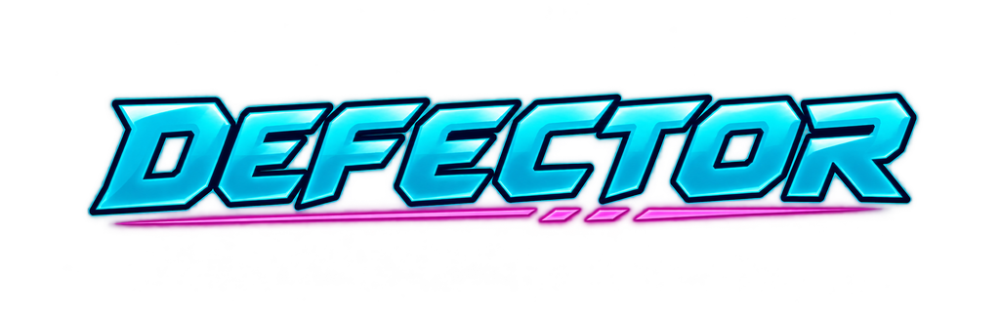

# DEFECTOR



> "Chicken Invaders meets a CoD campaign."

A neon 2D space shooter where every enemy fleet belongs to the woman you used to serve. You play **General Arden Vale**, who defected from Sovereign Isolde Varn's Sovereignty to the Free Worlds Coalition. Over three short levels you escort a convoy, lose a mentor, and bring down Isolde's Flagship. All of it is told through in-game comms, with no cutscenes.

**Status:** v1.0. Download the Windows build from the [Releases](../../releases) page.

## The game

- **Fixed-screen arcade shooting:** your ship sits right on the mouse cursor in the bottom 60% of the screen. Hold LMB for the laser, and press RMB for a missile that fires straight up.
- **Energy abilities:** destroyed enemies and asteroids drop energy. Spend it on a Shield (E) or a homing Barrage (Q).
- **Size-scaled impact:** explosions, screen shake and hit-stop grow with what you destroy.
- **Story through comms:** paused briefings, rare mid-fight interruptions, a surrender offer you can accept (or not), and a Final Choice at the end.
- **3 levels:** Cargo Ambush (convoy escort), The Blockade, and Siege of the Throne World (Flagship boss).
- **One sitting:** about 10–15 minutes.

## Download and run

1. Download `DEFECTOR-v1.0-windows.zip` from [Releases](../../releases).
2. Unzip it anywhere and run `DEFECTOR.exe`. Nothing needs installing.
3. The exe isn't code-signed, so Windows SmartScreen may warn you: click **More info**, then **Run anyway**.

**Requirements:** Windows 10 or 11 (64-bit), graphics with Vulkan or Direct3D 12 support, a mouse and a keyboard.

**Play** always starts the story from the beginning (the opening comms, then Level 1). **Level Select** jumps straight to any level you've unlocked. Clearing a level unlocks the next one, and retries are unlimited.

Only your unlocked levels are saved (energy is never saved), in `%APPDATA%\DEFECTOR\`. The log is `%APPDATA%\DEFECTOR\logs\godot.log`. Delete the `DEFECTOR` folder to reset your progress.

Found a bug? Please open an issue on the [Issues](../../issues) page and attach `godot.log`.

## Controls

| Input | Action |
|---|---|
| Mouse | Fly: your ship sits on the cursor (bottom 60% of the screen) |
| Hold LMB | Laser |
| RMB | Missile, straight up (1.5 s cooldown) |
| E | Shield (costs 50 energy) |
| Q | Barrage: 12 homing micro-missiles (costs 100 energy) |
| LMB on dialogue | Advance the comms and pick a choice |
| Esc | Pause menu (Resume, Restart Level, Quit to Title) |
| F11 | Fullscreen / windowed |

## Credits

Every third-party asset in DEFECTOR is free and CC0. The pieces made for this project are project-owned.

- **Kenney** ([kenney.nl](https://kenney.nl)): the ship, enemy, asteroid and background art (Space Shooter Redux and Extension), most sound effects (Sci-Fi Sounds, Interface Sounds) and the Kenney Future font.
- **OpenGameArt authors:** MintoDog ("Space Adventure" and "Space Boss Battle", the music), isaiah658 ("Heavenly Loop", the epilogue music) and bretbernhoft (the comms static).
- **Project-owned** (made for this project, not CC0): the comms portraits and the logo (AI-generated with ChatGPT image generation), the Flagship hull, the app icon, the comms cues and the Maul alarm.

Every asset, its source and its licence are listed in [`game/assets/CREDITS.md`](game/assets/CREDITS.md).

DEFECTOR is made with the [Godot Engine](https://godotengine.org), which is under the MIT licence. The release zip's `CREDITS.txt` carries the asset list, then Godot's licence and the notices of the third-party code compiled into the engine (FreeType, mbedTLS, ENet and others), from [`release/GODOT_COPYRIGHT.txt`](release/GODOT_COPYRIGHT.txt).

## From source

- **Engine:** Godot 4.7.2 (standard build) with statically typed GDScript. Open the `game/` folder in Godot and press F5.
- **Content:** all tuning, waves and dialogue are data-driven JSON in `game/data/`.
- **Tools:** the Python tools in `tools/` use only the standard library. Run them with [uv](https://docs.astral.sh/uv/) as shown below, or with any Python 3 (`python tools/<tool>.py`).
- **Tests:** GUT 9.7.1 for logic and data tests, plus stdlib `unittest` tests for the Python tools in `tools/`. `<GODOT_DIR>` is your Godot folder:

```bash
"<GODOT_DIR>/Godot_v4.7.2-stable_win64_console.exe" --headless --path game --import
"<GODOT_DIR>/Godot_v4.7.2-stable_win64_console.exe" --headless --path game -s addons/gut/gut_cmdln.gd -gdir=res://tests -ginclude_subdirs -gexit
uv run python -m unittest discover -s tools -p "test_*.py"
```

### Making a release

With the Godot 4.7.2 export templates installed, from the repo root:

```bash
# 1. Export the release build (gitignored: game/export/)
"<GODOT_DIR>/Godot_v4.7.2-stable_win64_console.exe" --headless --path game --import
"<GODOT_DIR>/Godot_v4.7.2-stable_win64_console.exe" --headless --path game --export-release "Windows Desktop" export/windows/DEFECTOR.exe
uv run python tools/perf_check.py size game/export/windows

# 2. Build DEFECTOR-v<version>-windows.zip (exe + README.txt + CREDITS.txt; the version comes from game/project.godot)
uv run python tools/package_release.py

# 3. Check the tracked files, archives included, for secrets, real emails and machine paths
#    (add --deny "<text>" for your own identifiers; it prints path:line: rule for each finding, never the text)
uv run python tools/repo_hygiene.py

# 4. Smoke test: unzip into an empty folder, then
uv run python tools/perf_check.py launch <folder>/DEFECTOR.exe --runs 3

# 5. Push (maintainer only): gh creates the v1.0 tag from the pushed default branch
git push

# 6. Publish (maintainer only)
gh release create v1.0 DEFECTOR-v1.0-windows.zip --title "DEFECTOR v1.0" --notes-file RELEASE_NOTES.md
```

`repo_hygiene.py` currently reports findings in four `.bmad-loop/archive/` run archives. They hold machine-specific run logs that must not be published, and they will keep failing the check until they are purged from the history.

The player-facing readme in the zip is [`release/README.txt`](release/README.txt), and the release notes are [`RELEASE_NOTES.md`](RELEASE_NOTES.md).

`release/GODOT_COPYRIGHT.txt` is generated from the engine itself. Regenerate it whenever the Godot version changes:

```bash
"<GODOT_DIR>/Godot_v4.7.2-stable_win64_console.exe" --headless --script tools/godot_copyright.gd -- release/GODOT_COPYRIGHT.txt
```

## How it was planned

This project is also a run-through of the **BMAD Method** (with its game-dev module), done with AI agents. Every planning artifact is in the repo:

| Artifact | Path |
|---|---|
| Brainstorming and game brief | `_bmad-output/brainstorming-session-2026-10-06.md`, `_bmad-output/planning-artifacts/briefs/` |
| Game Design Document and decision log | `_bmad-output/planning-artifacts/gdds/` |
| Architecture | `_bmad-output/game-architecture.md` |
| UX spec and HUD mockup | `_bmad-output/planning-artifacts/ux-designs/` |
| Epics and stories | `_bmad-output/planning-artifacts/epics.md` |
| Implementation readiness report | `_bmad-output/planning-artifacts/implementation-readiness-report-2026-10-06.md` |
| Story specs and retrospectives | `_bmad-output/implementation-artifacts/` |

`_bmad/`, `.agents/` and `.claude/` hold the BMAD tooling and agent skills. `AGENTS.md` holds the rules for AI agents working in this repo.

## Repository layout

```
game/            Godot project (res://): code, scenes, data, assets, GUT tests
tools/           stdlib Python tools (asset import, perf checks, beat audit, packaging, repo hygiene) and their tests,
                 plus godot_copyright.gd (the engine licence notices)
release/         README.txt and GODOT_COPYRIGHT.txt, shipped inside the release zip
_bmad-output/    planning documents (GDD, architecture, UX, epics, story specs)
_bmad/ .agents/ .claude/   BMAD method tooling and agent skills
AGENTS.md        rules for AI agents
```

Non-commercial hobby project.
